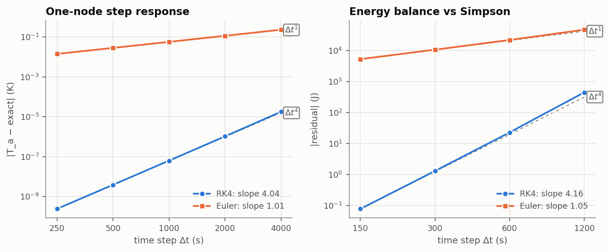
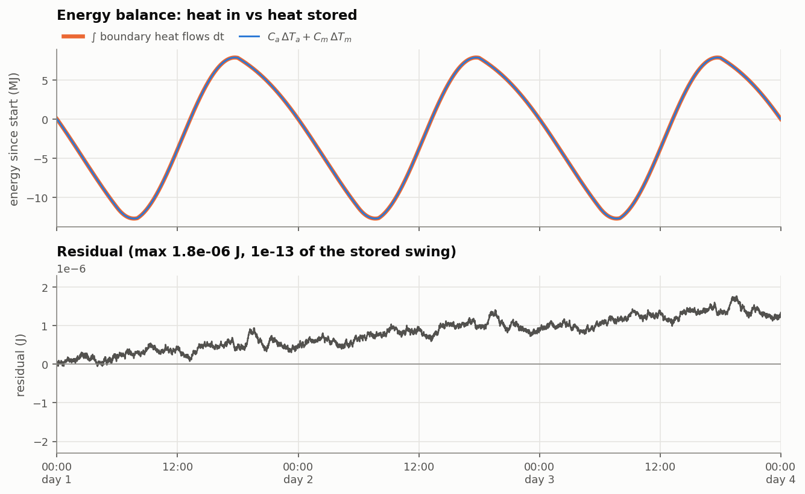
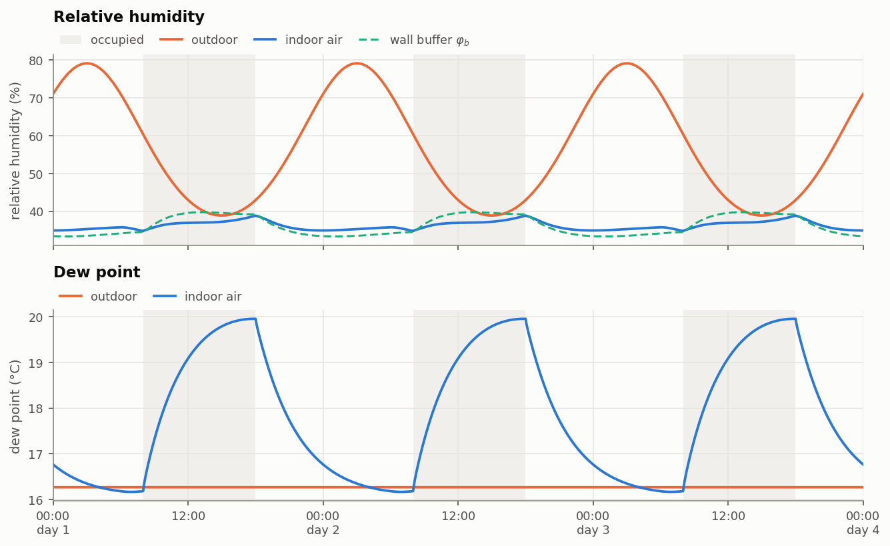

# roomsim: a dynamic room model for HVAC control

A small simulator of a single room with an inverter split air conditioner, verified against
analytical solutions, used to test and compare air-conditioning controllers.

The room has an air node, a thermal-mass node, a moisture balance with buffering by the
interior surfaces, a CO2 balance and proper psychrometrics. It is driven by outdoor weather,
sun through a window and occupants coming and going. The unit model resolves the cooling coil
(dry and wet), the water held on the coil, frost protection, part-load efficiency and start-up
losses. Controllers are discrete: they sample the sensors every Δt_c and hold their commands,
as a real unit does.


## Model

State x = [T_a, T_m, W, φ_b, C] for the room, plus the water M_c held on the coil when a unit
is present. Plant input u = [Q_hvac_sens, ṁ_hvac_lat, V_vent].

```
C_a dT_a/dt  = H_am (T_m - T_a) + (H_ao + H_inf + H_vent)(T_o - T_a) + f_sol,a Q_sol + Q_int,conv + Q_hvac
C_m dT_m/dt  = H_am (T_a - T_m) + H_mo (T_o - T_m) + (1 - f_sol,a) Q_sol + Q_int,rad
ρV  dW/dt    = ρ(V n/3600 + V_vent)(W_o - W) + N g_vap - ṁ_hvac_lat + ṁ_buf
C_b dφ_b/dt  = -ṁ_buf,      ṁ_buf = G_b (φ_b p_ws(T_m) - p_w(W))
V   dC/dt    = (V n/3600 + V_vent)(C_o - C) + N G_CO2
```

| Symbol | Meaning | Value |
|---|---|---|
| C_a | air + light furnishings | 0.33 MJ/K |
| C_m | walls, floor, heavy furniture | 10 MJ/K |
| H_am | air ↔ mass, h_i·A_int | 180 W/K |
| H_ao, H_mo, H_inf | window, opaque envelope, infiltration (0.5 ach) | 4, 25, 9.05 W/K |
| C_b, G_b | moisture buffer (EMPD, painted gypsum) | 1.44 kg, 5.2·10⁻⁷ kg/(s·Pa) |
| G_CO2 | CO2 per person (1.2 met) | 0.0052 L/s |

Room 5 × 4 × 2.7 m, two occupants 8-18 h (70 W, 0.05 kg/h each), 3 m² window (g = 0.6),
sinusoidal summer day 20-32 °C. Full specification, including where and why it departs from
its first version: [docs/specification.md](docs/specification.md).

Time scales: air ≈ 1 700 s, mass ≈ 3.1 days, air-buffer moisture exchange ≈ 900 s,
apparent room moisture ≈ 15 000 s (twice the 7 200 s of the air alone).

### Air-conditioning unit

Inverter split unit, 2.5 kW at 35 °C outdoor, EER 3.5 at rating conditions. The controller sends
compressor speed s (0 or 0.3-1), indoor fan speed f and ventilation flow; the unit converts them
into Q_hvac_sens and ṁ_hvac_lat at every Runge-Kutta stage.

| Item | Model |
|---|---|
| Coil | bypass factor / apparatus dew point, BF = 0.15 at 450 m³/h, NTU ∝ ṁ^-0.4 |
| Dry / wet coil | closed form when dry; Newton on the saturation enthalpy when wet; continuous at the switch |
| Sensible / latent split | exact for the enthalpy definition: Q_sens + Q_lat = ṁ Δh to round-off |
| Cycle | Carnot fraction with finite-UA evaporator and condenser, closed form, calibrated to the rated EER |
| Frost protection | capacity capped so the evaporating temperature stays ≥ 0.5 °C |
| Start-up | capacity ramps with a 60 s time constant while the compressor draws full power |
| Coil water | condensate wets the coil (0.25 kg) before it drains; re-evaporates with the fan on and the compressor off |

At rating conditions the sensible heat ratio is 0.73 and the supply air 15 °C. Lower fan speed
gives a colder coil, more dehumidification and a lower COP; part load raises the EER to 4.0.

## Results

### Free-floating baseline

Without air conditioning, on the **periodic steady state** found by Newton shooting on the
one-day map, the room peaks at **T_a,max = 36.8 °C at 15:07** (minimum 33.4 °C, indoor RH
35-39 %). With 0.5 ach, an unshaded window and about 340 W of mean gains, the room sits ~9 K
above the mean outdoor temperature. Starting from a uniform 26 °C instead underestimates the
peak by almost 4 K on day 3, because the mass takes about three days to respond.


### Standard controllers

Three summer days after three warm-up days, set point 25 °C, ventilation 38 m³/h during
occupied hours (mean CO2 950 ppm):

| Controller | Energy (kWh) | Starts | T rms occ. (K) | RH mean occ. (%) | h RH > 60 % occ. |
|---|---|---|---|---|---|
| On/off thermostat (±0.5 K, full speed) | 11.38 | 174 | 0.35 | 49.2 | 0.0 |
| On/off, fan continuous | 9.92 | 117 | 0.40 | 64.1 | 26.2 |
| PI + hysteresis low-load handling (A) | 6.11 | 66 | 0.25 | 64.1 | 28.4 |
| PI + sigma-delta low-load handling (C) | 6.12 | 84 | 0.29 | 63.7 | 27.2 |
| PI (C), fan continuous | 7.13 | 88 | 0.29 | 63.8 | 27.2 |


**The PI halves the energy but loses humidity control.** The unit is large for this office, as
is common in practice, so the PI keeps it at minimum speed most of the time. At s = 0.3 and full
fan the coil surface sits near 19 °C, above the dew point of the room air (about 16 °C): the coil
runs dry and removes no water at all (sensible heat ratio 1.00 against 0.80 for on/off). The
mean EER rises from 2.6 to 4.5, but indoor RH climbs to 64 %. Recovering dehumidification at part
load is the subject of the next section.

**Leaving the fan on between cycles returns the condensate to the room.** With the on/off
thermostat, continuous fan raises the mean RH from 49 % to 64 %: the water held on the coil
re-evaporates during the off periods, and most of it never reaches the drain. This is the
part-load latent degradation reported for cycling units. Under PI control the unit modulates
rather than cycles during occupied hours, so the effect there is small.

**Low-load handling.** Below the 30 % minimum speed the compressor has to cycle. The PI computes
a continuous demand and a separate handler turns it into feasible commands, with minimum run and
stop times of 3 min. Handler A (thermostatic hysteresis, integrator frozen) is what many units
do; handler C (sigma-delta) meets the mean demand exactly, so the PI keeps integrating.

### Humidity-aware fan control

The indoor fan is the dehumidification actuator: less airflow means a colder coil and a lower
sensible heat ratio. At minimum compressor speed, going from full to 40 % fan takes the coil from
19 °C (dry) to 15 °C (wet), SHR 1.00 to 0.76, for a 5 % loss of EER. The compressor stays under the
same PI temperature loop; two structures drive the fan:

- **H1**: a relative-humidity PI acting directly on the fan speed.
- **H2, cascade**: the RH loop sets a coil-temperature target, and an inner loop on the
  evaporator thermistor moves the fan to reach it.

Set points 25 °C and 55 % RH:

| Controller | Energy (kWh) | Water removed (kg) | RH mean occ. (%) | RH std occ. (%) | h RH > 60 % occ. |
|---|---|---|---|---|---|
| PI (C), full fan | 6.12 | 0.0 | 63.7 | 2.15 | 27.2 |
| H1 fan RH-PI | 7.20 | 5.3 | 55.3 | 0.82 | 0.0 |
| H2 cascade | 7.20 | 5.3 | 55.2 | 0.50 | 0.0 |
| On/off (reference) | 11.38 | 8.6 | 49.2 | 1.54 | 0.0 |


Both bring the humidity back to its set point for 18 % more energy than the plain PI, still 37 %
less than on/off. The two structures have the same mean performance; the cascade holds humidity
more steadily and moves the fan about half as much. Keeping the controllers tuned for the nominal
unit and running them on a different one (dirty coil with bypass factor 0.30, or a 3.5 kW unit)
gives the same ordering: RH standard deviation 0.50-0.76 % for the cascade against 0.82-0.98 %
for H1. The advantage is real but small, as expected when the outer process (room humidity) is
much slower than anything the inner loop rejects.

## Verification

All checks run in `pytest` (125 tests, about a minute).

| Check | Result |
|---|---|
| Psychrometrics: p_ws(20 °C), W(25 °C, 50 %), T_d(20 °C, 50 %) | 2333 Pa, 0.00986 kg/kg, 9.26 °C |
| Steady state vs 2×2 linear solution (3 cases) | < 10⁻⁶ K |
| Daily mean of periodic solution vs steady state of mean inputs | < 2·10⁻³ K |
| One-node step vs exponential, convergence order | RK4 **4.04**, Euler **1.01** |
| Energy, water and CO2 closure, flows integrated as extra states | round-off (~10⁻¹³ relative) |
| Energy residual with independent Simpson quadrature, order | RK4 **4.16**, Euler **1.05** |
| Moisture decay without buffer, fitted τ vs 3600/n | 10⁻⁸ relative |
| Moisture decay with buffer vs linearised two-exponential solution | < 10⁻³ of the perturbation |
| CO2 decay with ventilation vs exponential | 10⁻⁹ of the amplitude |
| Full scenario vs `scipy` Radau (rtol 10⁻¹¹) | < 10⁻⁶ K |
| Coil: Q_sens + Q_lat vs ṁ Δh; outlet RH ≤ 100 % on 168 conditions | round-off; always |
| Room + coil water balance in closed loop (drain integrated) | round-off |
| Unit inside the integrator, closed-loop convergence order | **3.9** |
| PI anti-windup: integrator under saturation vs analytical value | 10⁻⁹ |
| Sigma-delta: mean delivered demand, cycle length vs design formula | ±0.01, ±10 % |
| Cascade inner loop on the real coil: coil temperature vs its set point | ±0.05 K |



The energy balance is checked at two levels. Any Runge-Kutta method preserves
linear invariants, so integrating the boundary flows alongside the state closes the balance to
round-off whatever the step: that verifies signs and bookkeeping. Integrating the logged flows
with an independent quadrature (Simpson) gives a residual that falls with the order of the
method: that verifies accuracy.

**Coupling the unit.** The coil output depends on the return-air state, so it is evaluated at
every Runge-Kutta stage while only the commands are held between samples. Evaluating the unit
once per sample and holding Q_sens instead drops the closed loop to first order: at Δt = 60 s
the error grows from 10⁻¹⁰ K to 2·10⁻⁴ K.

**Stiffness.** The fastest mode is the air-buffer moisture exchange, and it stiffens with
temperature because the buffer flux scales with p_ws(T_m). The explicit-Euler stability limit is
≈ 790 s at 26 °C and ≈ 380 s at 48 °C; RK4 at 60 s has ample margin.





## Layout

```
src/roomsim/
  psychro.py       psychrometric functions
  params.py        RoomParams dataclass, derived constants
  inputs.py        disturbance scenarios d(t), vectorised for forecasts
  plant.py         rhs(t, x, u, d, p), flux breakdown, Jacobian, sensors
  ac_unit.py       inverter split unit: coil, cycle, frost protection, start-up, coil water
  integrators.py   Euler, RK4, Euler stability limit
  simulate.py      fixed-step loop, discrete controller with zero-order hold, periodic shooting
  results.py       SimResult: states, psychrometrics, balance residuals
  metrics.py       energy, starts, comfort, humidity and CO2 indicators
  verification.py  analytical solutions and convergence studies (shared by tests and figures)
  plotting.py      figures
  controllers/     on/off thermostat, discrete PI with anti-windup, low-load handlers,
                   humidity-aware fan control (direct and cascade)
scripts/run_baseline.py         free-floating baseline and verification figures
scripts/compare_controllers.py  controller comparison table and figures
scripts/compare_humidity.py     humidity-aware fan control and robustness to the unit
tests/
docs/specification.md
```

## Install and run

```bash
pip install -e .[dev]
pytest -v
python scripts/run_baseline.py
python scripts/compare_controllers.py
python scripts/compare_humidity.py
```

## Roadmap

1. Linear MPC with a Kalman filter estimating the unmeasured mass temperature, tested under
   ±20 % model mismatch.
2. Ventilation-level strategies driven by CO2.
