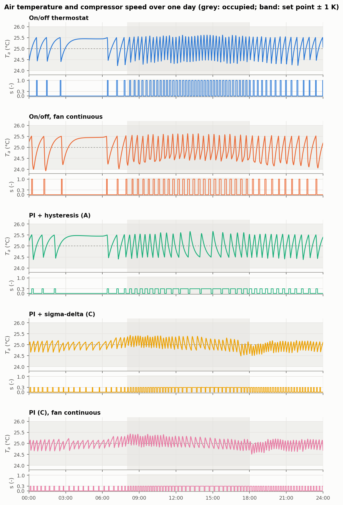

# roomsim: a dynamic room model for HVAC control

A small simulator of one office room with an inverter split air conditioner. It is verified
against analytical solutions and used to test and compare air-conditioning controllers.

- **The room:** an air node, a thermal-mass node, a moisture balance with buffering by the
  interior surfaces, a CO2 balance and proper psychrometrics.
- **What drives it:** outdoor weather, sun through a window, and occupants coming and going.
- **The unit model:** the cooling coil (dry, partially wet or wet), capacity that falls with
  airflow and evaporating temperature, the water held on the coil, frost
  protection, part-load efficiency and start-up losses.
- **The controllers:** discrete, as in a real unit. They sample the sensors every minute and
  hold their commands until the next sample.



## Main findings

All results are from simulation of one synthetic summer day, repeated (see Limits below).

1. **A proportional-integral (PI) controller uses 30 % less energy than an on/off thermostat
   but loses most of the humidity control.**
   - The unit is oversized for the room, so the PI runs it at minimum speed, where the coil is
     only partly wet (at most about half of its surface).
   - Mean indoor relative humidity while occupied rises from 50 % to 62 %.
2. **Slowing the indoor fan restores dehumidification.** The humidity returns to its 55 % set
   point for 9 % more energy than the plain PI, and still 23-24 % less than on/off. This includes
   the capacity the unit loses at low airflow. A cascade through the coil temperature holds the
   humidity a little more steadily.
3. **Model predictive control (MPC) saves little energy against a well-scheduled PI:** 1.6 %
   against a PI with set-back starting at 6:00, and nothing against one starting at 7:00.
   - The nominal MPC has a perfect weather forecast and exact model parameters; with 20 %
     parameter errors its energy rises by 1.6 %, with a biased forecast by less than 1 %.
   - With a time-of-use tariff (peak four times off-peak) it costs 7 % less than the set-back
     PI, for 16 % more energy. This depends on the night-time efficiency of the unit, which the
     model bounds conservatively. An earlier "10 % saving" was traced to an unbounded
     efficiency at night and withdrawn.
4. **Demand-controlled ventilation pays only when occupancy varies.** A fixed flow sized for
   the peak needs 78 % more air and 7 % more energy. Night flush pays only at about half the
   design flow.
5. **The numerics are verified.**
   - Fourth-order convergence with the unit inside the integrator, with a constant command and
     in closed loop with the sampled PI, while the coil stays in one regime; second order on
     trajectories that cross from a fully wet into a partially wet coil.
   - Energy, water and CO2 balances closed to round-off.
   - 170 automated tests.

## Limits

- One zone with well-mixed air, and one sinusoidal summer day repeated; no measured weather.
- The model has not been validated against measurements of a real room. Room and unit
  parameters are plausible for a small office and a 2.5 kW split unit, not fitted to a
  specific building or product.
- The findings are comparisons between controllers on the same model. Absolute energies
  depend on parameters such as the minimum condensing lift and the start-up time constant.
- Against the published data of a current 2.5 kW inverter split, the model's rated capacity is
  3 % lower and its minimum capacity 24 % lower; its EER is 23 % lower at rating and much lower
  in mild weather
  ([docs/results.md](docs/results.md#comparison-with-a-real-unit)).
- The full list is at the end of [docs/decisions.md](docs/decisions.md).

## Documentation

Read in this order:

1. [docs/model.md](docs/model.md): the equations, the parameters and the air-conditioning unit.
2. [docs/results.md](docs/results.md): every study with its table and figure. The findings
   above come from here.
3. [docs/verification.md](docs/verification.md): what is checked and how accurately.
4. [docs/decisions.md](docs/decisions.md): the log of modelling and study decisions (D1-D34).
   It records which ones were fixed before running a study, the corrections made after the
   end-of-project check and after an external review, and the known limitations.
5. [docs/faq.md](docs/faq.md): questions a reviewer may ask, with short answers.
6. [docs/specification.md](docs/specification.md): the full specification and its
   revisions.
7. [tests/README.md](tests/README.md): how test tolerances are chosen.
8. [docs/references.md](docs/references.md): the publications and data sources cited, what was
   read in each and what is taken from it.

## Install and run

Python 3.11 or later.

```bash
pip install -e ".[dev]"
python scripts/reproduce.py --check
```

`reproduce.py` runs every study in turn (about five minutes), writes the figures and result
tables to `figures/`, checks that the tables quoted in `docs/` match them, and with `--check`
fails if any regenerated file differs from the committed one. The studies are deterministic,
so on a clean checkout every file is reproduced byte for byte. Each study can also be run on
its own, for example `python scripts/compare_mpc.py`.

## Development

```bash
pytest                  # about 3 minutes
ruff check .            # lint (pyflakes, pycodestyle, bugbear, docstrings, numpy rules)
mypy                    # strict type check of src/ and scripts/
```

- Every public module, class and function has a numpy-style docstring with the units of each
  physical quantity (SI unless stated; temperatures in degC).
- Variable names follow the physics notation of [docs/model.md](docs/model.md) (`T_a`,
  `Q_lat`, `UA_evap`), so the naming rules of PEP 8 are relaxed for them.
- The code is not run through an automatic formatter: parameter tables keep their aligned
  columns of units and sources, which a formatter would remove. Line length is checked by the
  linter instead.
- `tests/test_docs_consistency.py` compares every number in the result tables of `docs/` with
  the tables the scripts generate.

## Layout

```
src/roomsim/
  _typing.py       shared type aliases (FloatArray, FloatOrArray, BoolArray)
  psychro.py       psychrometric functions
  params.py        RoomParams dataclass, derived constants
  inputs.py        disturbance scenarios d(t), vectorised for forecasts
  plant.py         rhs(t, x, u, d, p), flux breakdown, Jacobian, sensors
  ac_unit.py       inverter split unit: partially wet coil, capacity, cycle, frost protection,
                   fans, start-up, coil water
  integrators.py   Euler, RK4 (classical fourth-order Runge-Kutta), Euler stability limit
  simulate.py      fixed-step loop, discrete controller with zero-order hold, periodic shooting
  results.py       SimResult: states, psychrometrics, balance residuals
  metrics.py       energy, starts, comfort, humidity and CO2 indicators
  verification.py  analytical solutions and convergence studies (shared by tests and figures)
  plotting.py      figures
  control_model.py linear RC model for the controllers, exact discretisation
  estimation.py    Kalman filter with a disturbance state (offset-free)
  tariff.py        time-of-use electricity price
  ventilation.py   ventilation fan power (affinity law)
  controllers/     on/off thermostat, discrete PI with anti-windup, low-load handlers,
                   humidity-aware fan control (direct and cascade), economic MPC,
                   ventilation strategies (scheduled, CO2 PI, staged, night flush)
scripts/           one script per study, and reproduce.py to run them all
tests/             170 tests; tolerance rules in tests/README.md and tests/criteria.py
docs/              model, results, verification, decisions, FAQ, specification, references
figures/           figures and result tables written by the scripts
```

## Roadmap

1. MPC with humidity in the model, so that the planner can trade sensible against latent load.
2. Ventilation inside the MPC, so that night flush and demand control are planned together.

## License

MIT, see [LICENSE](LICENSE).
