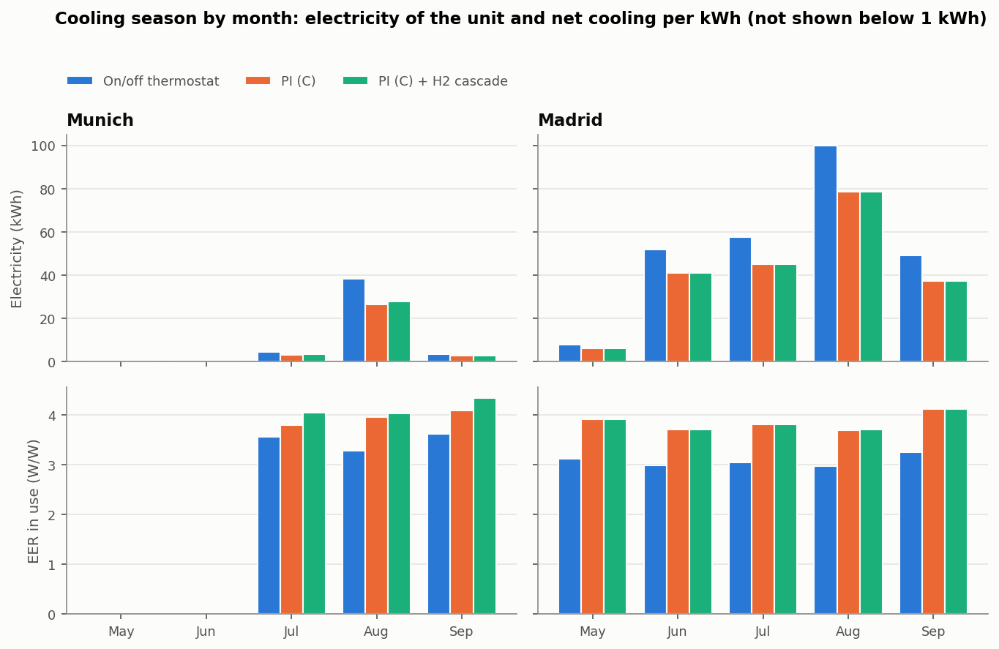
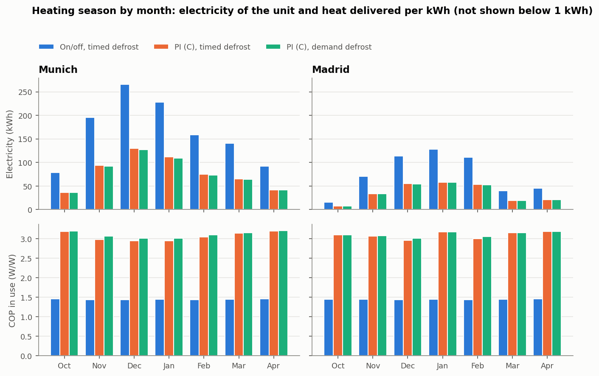

# Results

Each study can be reproduced with the script named in its section (see
[Install and run](../README.md#install-and-run) in the main README). The scripts also write
each table to `figures/`. Where a study was designed before running it, the design is in
[decisions.md](decisions.md).

Abbreviations used below: RH, relative humidity; PI, proportional-integral controller; EER,
energy efficiency ratio (net cooling delivered, that is coil capacity minus indoor fan heat, per
unit of electrical energy); SHR, sensible heat ratio (sensible over total cooling); MPC,
model-predictive control; ach, air changes per hour.

Questions a reviewer may ask about these results are answered in [faq.md](faq.md).

## Free-floating baseline

Script: `scripts/run_baseline.py`.

Without air conditioning, on the **periodic steady state** found by Newton shooting on the
one-day map, the room peaks at **T_a,max = 36.8 °C at 15:07** (minimum 33.4 °C, indoor RH
35-39 %). With 0.5 ach, an unshaded window and about 340 W of mean gains, the room sits ~9 K
above the mean outdoor temperature. Starting from a uniform 26 °C instead underestimates the
peak by almost 4 K on day 3, because the mass takes about three days to respond.

## Standard controllers

Script: `scripts/compare_controllers.py`.

Three summer days after three warm-up days, set point 25 °C, ventilation 38 m³/h during
occupied hours (mean CO2 950 ppm):

| Controller | Energy (kWh) | Starts | T rms occ. (K) | RH mean occ. (%) | h RH > 60 % occ. |
|---|---|---|---|---|---|
| On/off thermostat (±0.5 K, full speed) | 10.54 | 171 | 0.35 | 50.0 | 0.0 |
| On/off, fan continuous | 9.88 | 117 | 0.40 | 64.1 | 26.2 |
| PI + hysteresis low-load handling (A) | 6.85 | 105 | 0.34 | 62.3 | 27.8 |
| PI + sigma-delta low-load handling (C) | 7.39 | 251 | 0.20 | 62.4 | 27.7 |
| PI (C), fan continuous | 8.45 | 261 | 0.18 | 63.8 | 27.8 |

"T rms occ." is the root-mean-square deviation of the air temperature from the set point while
occupied; "h RH > 60 % occ." is the number of occupied hours above 60 % RH.

**The PI uses 30 % less energy but loses most of the humidity control.** The unit is large for
this office, so the PI keeps it at minimum speed for most of its running time (95 % for handler
C). At s = 0.3 and full fan, once the start-up ramp has decayed, the mean coil surface sits at
17.2-18.0 °C, about at the dew point of the room air (17.4 °C on average while occupied). The coil
is only partly wet: 31-52 % of its surface, 43 % on average. Over all its running time, including
the start-up ramps of its 251 starts, during which the coil is warmer, the wetted fraction
averages 21 %. It removes 0.9 kg of water in three
days against 9.4 kg for on/off (SHR 0.98 against 0.81). The mean net EER is 3.41 against 2.80,
and indoor RH climbs to 62 %. Recovering dehumidification at part load is the subject of the
next section.

Before the coil model was made partially wet (decision D29), the same coil was completely dry at
these conditions and removed no water at all, with a mean occupied RH of 63.7 %. That value was
an upper bound within the model; after all the unit changes D29-D32 it is 62.4 % (the share of
D29 alone was not computed). The
partially wet model is itself an estimate, not a bound: it leaves out the warmer superheated end
of the evaporator and the colder fin roots, which act in opposite directions.

The script does not print these mean values. They come from the same runs (PI with handler C
and the on/off thermostat): net EER as coil capacity minus indoor fan heat, over electrical
energy (decision D32); SHR as sensible over sensible plus latent cooling, both summed over the
three days; coil range and wetted fraction over the minimum-speed, full-fan samples from
5 minutes after each start, unless stated otherwise.

**Leaving the fan on between cycles returns the condensate to the room.** With the on/off
thermostat, continuous fan raises the mean RH from 50 % to 64 %: the water held on the coil
re-evaporates during the off periods, and none of it reaches the drain over the three days.
This is the mechanism of part-load latent degradation in cycling units described by Henderson
and Rengarajan (1996; see [references.md](references.md)). Under PI control, which
condenses little water in the first place, the effect is smaller (62.4 % to 63.8 %).

**Low-load handling.** Below the 30 % minimum speed the compressor has to cycle. The PI computes
a continuous demand and a separate handler turns it into feasible commands, with minimum run and
stop times of 3 min. Handler A (thermostatic hysteresis, integrator frozen) switches like a
thermostat around the minimum speed; handler C (sigma-delta) meets the mean demand, so the PI
keeps integrating.

- **Time scale of the sigma-delta handler.** It follows from the ripple it causes. Between
  switches the energy mismatch is stored in the air, so the peak-to-peak ripple is
  s_min T_ref Q_d / C_a, with Q_d the sensible cooling per unit of demand at minimum speed.
  T_ref = 163 s gives 0.5 K. Measured over 219 low-load cycles in closed loop: median 0.48 K.
- **Clamped accumulator.** A deficit held back by the minimum run or stop time is not paid back
  later; paying it back had kept the unit off while the room was already warm.
- **Outcome.** Handler C gives the tightest temperature control, with more but shorter cycles
  than A: 251 starts against 105, or 8.0 starts per running hour against 3.6 for A and 10.3 for
  on/off. It also uses 8 % more energy than A. The capacity at minimum speed rises when the
  evaporator is warm at low load (decision D30), so the unit cycles more than in earlier versions
  of the model (169 starts for C before).

## Humidity-aware fan control

Script: `scripts/compare_humidity.py`.

The indoor fan is the dehumidification actuator: less airflow means a colder coil and a lower
sensible heat ratio, but also a lower evaporating temperature and so less capacity (decision D30).
At minimum compressor speed (room at 25 °C and 60 % RH, 32 °C outdoors), going from full to 40 %
fan takes the mean coil surface from 17.7 °C (dry) to 14.4 °C (fully wet), SHR 1.00 to 0.70, with
10 % less capacity and a 3 % loss of net EER. The net sensible cooling (sensible minus the indoor
fan heat) per unit of electricity falls by 32 %, because almost a third of the cooling now removes
water. The compressor stays under the same PI temperature loop; two structures drive the fan:

- **H1**: a relative-humidity PI acting directly on the fan speed.
- **H2, cascade**: the RH loop sets a coil-temperature target, and an inner loop on the
  evaporator thermistor moves the fan to reach it.

Set points 25 °C and 55 % RH:

| Controller | Energy (kWh) | Water removed (kg) | RH mean occ. (%) | RH std occ. (%) | h RH > 60 % occ. |
|---|---|---|---|---|---|
| PI (C), full fan | 7.39 | 0.9 | 62.4 | 1.36 | 27.7 |
| H1 fan RH-PI | 8.06 | 5.2 | 55.4 | 0.88 | 0.0 |
| H2 cascade | 8.07 | 5.2 | 55.2 | 0.60 | 0.0 |
| On/off (reference) | 10.54 | 9.4 | 50.0 | 1.30 | 0.0 |

Water removed is the condensate drained over the three days (the water held on the coil is
the same at both ends), taken from the integrated drain total.

Both bring the humidity back to its set point for 9 % more energy than the plain PI, still 23-24 %
less than on/off. The 9 % includes the capacity lost at low airflow (decision D30) and the
speed-independent part of the fan power (D31); it was 10 % before the unit changes D29-D32. The
two structures have the same mean performance; the cascade holds humidity more steadily. Keeping
the controllers tuned for the nominal unit and running them on a different one (dirty coil with
bypass factor 0.30, or a 3.5 kW unit) gives the same ordering: across the three units the RH
standard deviation is 0.60-0.84 % for the cascade against 0.88-0.94 % for H1. The advantage is
real but small (with the 3.5 kW unit 0.84 against 0.88 %), as expected when the outer process
(room humidity) is much slower than anything the inner loop rejects. The steadier humidity costs
fan movement: H1 moves the fan less than the cascade on all three units, 0.14-0.26 against
0.26-0.36 of full speed per running hour (`figures/humidity_control.md`; only steps between
consecutive samples with the compressor running are counted, decision D38).

While the compressor runs, both keep the fan at about 56 % on average and never at its minimum,
and the evaporating temperature stays above 12.5 °C, far from the frost limit of 0.5 °C.

## Model-predictive control

Script: `scripts/compare_mpc.py`.

An economic MPC plans the air temperature over the next 24 h in 15-minute steps and re-plans
every 15 minutes. It minimises:

- the forecast electrical energy (the unit's coefficient of performance, COP, is better in the
  cool hours), weighted by the electricity price when there is a tariff;
- a penalty for leaving the comfort band (25 ± 1 °C while occupied, up to 28 °C otherwise);
- a small penalty on changes of the planned cooling.

The prediction model is the linear two-node RC model, discretised exactly; it knows nothing
about humidity, the coil or the unit's part-load behaviour. The cost and constraints are linear
(the absolute changes of cooling are written with auxiliary variables), so each plan is a
linear programme, solved with the HiGHS solver through SciPy in about 10 ms.

A Kalman filter on the air-temperature sensor estimates the unmeasured mass temperature and an
unknown heat input to the air. The second state makes the predictions offset-free: whatever the
model gets wrong shows up as a disturbance that the planner then compensates. Started 3 K wrong
on the mass temperature, the estimate converges without bias but slowly (time constant ~14 h),
because with a single air sensor a wrong mass temperature and an unknown heat input can only be
told apart through the slow mass mode.

The MPC supervises the PI rather than driving the compressor directly. Applying the planned
cooling directly, with the low-load handler turning it into cycling between the 15-minute
solves, left the cycling without feedback and produced 3.75 K·h outside the band over three days.
In the final structure the plan sets the PI's set point, and the PI (60 s) does the tracking and
the cycling. The planner keeps 0.6 K inside the occupied band for the PI's ripple; the margin
was chosen from a sweep (0.3 K: 0.18 K·h outside the band, 0.6 K: 0.000 K·h, for 4 % more
energy; see D18 and D21 in [decisions.md](decisions.md); the sweep was run before the MPC
corrections D35 and D36). The PI's set point is the planned temperature at the end of the
current 15-minute step, kept inside the band that applies at that instant (D35), and the
planner's capacity and cost are net of the indoor-fan heat, like the cooling the Kalman filter
sees (D36).

Three days, ventilation during occupied hours, tariff 0.15 / 0.60 EUR/kWh with the peak 14-20 h:

| Controller | Energy (kWh) | Cost (EUR) | K·h outside band | Starts |
|---|---|---|---|---|
| PI, 25 °C constant | 7.39 | 2.48 | 0.000 | 251 |
| PI, set-back, fixed start 6:00 | 6.41 | 2.13 | 0.000 | 114 |
| MPC | 6.27 | 2.15 | 0.000 | 148 |
| MPC, time-of-use tariff | 7.41 | 1.97 | 0.000 | 183 |
| MPC, model parameters off by 20 % | 6.33 | 2.15 | 0.000 | 168 |
| MPC, forecast +2 K and -30 % sun | 6.25 | 2.15 | 0.000 | 145 |

The cost column applies the time-of-use tariff to every run, including those whose controller
does not know about it.

- **Against a well-configured PI the energy saving is small**: 2.2 % against set-back with a
  fixed start at 6:00, 15 % against a constant set point. The nominal MPC has a perfect weather
  forecast (the forecast is the scenario itself) and exact model parameters, so 2.2 % is what it
  achieves under ideal information; the last two rows relax each assumption once. Most of what
  the MPC finds (let the room float at night, start just in time, sit at the warm edge of the
  band) a PI with a good schedule already gets.
- **The 6:00 start of the reference is not optimised** (decision D33). With a start at 7:00 the
  set-back PI uses 6.29 kWh, 0.3 % more than the MPC's 6.27 kWh, and with a start at 7:30
  6.23 kWh, 0.6 % less than the MPC, without leaving the band.
  The MPC's advantage is that it finds the start by itself.
- **A time-of-use tariff now pays, at a price in energy.** With the tariff the MPC pre-cools
  overnight, storing cold in the thermal mass: it costs 7.5 % less than the set-back PI (1.97
  against 2.13 EUR) and 8 % less than the MPC without the tariff, but uses 16 % more energy than
  the set-back PI. Before the unit model changes of decisions D29-D32 it ended level with the
  set-back PI (1.97 against 1.96 EUR). Rerunning with the evaporating-temperature dependence of
  the capacity switched off (k_e = 0) nearly restores the earlier figures (set-back PI 5.94 kWh
  and 1.96 EUR, tariff MPC 6.32 kWh and 1.97 EUR, against 5.96 / 1.96 and 6.39 / 1.97 before),
  so that dependence causes the change: it raises
  the capacity at minimum speed, and the set-back PI then cycles more in the occupied hours (114
  starts against 51 before), each start with a ramp at full power (decision D9). The tariff MPC's
  cost hardly moves. (These attribution runs were made before the MPC corrections D35 and D36,
  which lowered the tariff MPC's cost from 1.99 to 1.97 EUR.) An earlier version reported a 10 %
  saving that was traced to an unbounded cycle COP at night (decision D20). The result depends on the night-time and part-load COP,
  which the 15 K minimum lift bounds, and the comparison with a real unit below shows that bound
  to be conservative.
- **Robustness**: 20 % errors in five model parameters raise the energy by 1.0 %, and a forecast
  2 K too warm with 30 % less sun lowers it by 0.3 %; both keep the comfort criterion.
  The Kalman disturbance state absorbs both.

**Load shifting has a threshold and a ceiling.** Single 24-hour plans (planner only, no closed
loop) were computed with different peak/off-peak price ratios, starting at 6:00 on the third day
from the state used in the tests (air 26.5 °C, mass 27.0 °C). The table gives the share of
planned cooling in the 14-20 h window that moves out of it, compared with a flat price:

| Planning band | Ratio 2.5 | Ratio 3 | Ratio 4 | Ratio 5 | Ratio 6 to 10 |
|---|---|---|---|---|---|
| 25 ± 1 °C, margin 0.6 K (default) | 0.2 % | 2.3 % | 5.2 % | 13.3 % | 14.2-14.6 % |
| 25 ± 1 °C, margin 0.3 K | 0.1 % | 4.0 % | 7.0 % | 19.6 % | 20.6-21.1 % |
| 25 ± 1.5 °C, margin 0.6 K | 0.0 % | 5.2 % | 8.2 % | 24.2 % | 25.2-25.7 % |

Below a ratio of about 3 almost nothing moves; from about 6 the share stops growing, at a level
set by how far the planner may pre-cool. Pre-cooling the air pulls heat out of the strongly
coupled mass (180 W/K), and much of it leaks back before the peak. The tariff of the closed-loop
runs above has a ratio of 4. These planning runs are not part of the scripts; the test suite
checks the two ends (no shift at a ratio of 2, a shift at 6). They were computed before the
planner's capacity and cost were made net of the indoor-fan heat (D36) and were not repeated.

## Ventilation

Script: `scripts/compare_ventilation.py`.

Ventilation strategies, all with the same temperature and humidity control (PI with sigma-delta
handling and the coil cascade), so differences come from ventilation only. The fan follows the
affinity law (30 W at 108 m³/h). The requirement is CO₂ ≤ 1 000 ppm while occupied. Strategies,
parameters, requirement and expected outcomes were committed before the runs
([decisions D23-D27](decisions.md)).

- **V0:** fixed schedule, 38 m³/h, close to the ASHRAE Standard 62.1 breathing-zone rate for
  two people in this office (D24).
- **V1:** PI on measured CO₂, set point 900 ppm, tuned with Skogestad's SIMC rules from the
  CO₂ balance.
- **V2:** three fan levels switched on CO₂ with hysteresis and a 5-minute dwell. This is the
  generic form of staged demand-controlled ventilation.
- **V3:** V1 plus mechanical night flush when the outdoor air is at least 2 K cooler than the
  room.

The ventilation rate and the SIMC rules are referenced in [references.md](references.md).

Variable office day (late arrival, empty at lunch, a 3-person meeting at 15 h, early leave):

| Strategy | Total energy (kWh) | Air (m³) | CO₂ max occ. (ppm) | h > 1 000 ppm |
|---|---|---|---|---|
| V0 fixed schedule (sized for 2 people) | 7.84 | 1134 | 1189 | 3.9 |
| V0 sized for the 3-person peak (exploratory) | 8.47 | 2095 | 966 | 0.0 |
| V1 demand-controlled PI | 7.91 | 1176 | 949 | 0.0 |
| V2 staged levels | 7.94 | 1180 | 955 | 0.0 |
| V3 V1 + night flush at 108 m³/h | 7.91 | 3741 | 949 | 0.0 |

Total energy is the air conditioner plus the ventilation fan over three days. The design case
(two people all day) and the flush-flow sweep are in `figures/ventilation_comparison.md`.

- **Demand control earns its keep only when occupancy varies.**
  - With two people present all day, V1 and V2 used more air than the fixed schedule (1 438
    and 1 366 against 1 134 m³). There was nothing to exploit, and their 900 ppm set point is
    stricter than where the fixed flow ends up (≈ 1 000 ppm).
  - With variable occupancy, the fixed flow breaks the requirement during and after the
    meeting.
  - A fixed flow sized for the peak meets it, but with 78 % more air and 7 % more energy than
    demand control.
- **Staged levels perform like the continuous PI with variable occupancy** (energy within 0.4 %,
  peak CO₂ within 6 ppm: 955 against 949 ppm). In the design case they differ more: V2 peaks at
  950 ppm against 901 ppm for V1 (49 ppm higher) with 5 % less air (1 366 against 1 438 m³) and
  the same energy within 0.3 % (8.30 against 8.32 kWh); both stay below 1 000 ppm. Three levels
  are enough to meet the requirement here; the continuous loop holds its set point more tightly
  when the load is steady.
- **Night flush pays only at reduced flow.** At the full 108 m³/h (design case) it saves
  0.72 kWh of compressor energy and the fan uses 0.71 kWh more: no net gain. An exploratory sweep
  of the flush flow (design case) gives the lowest total at 54-72 m³/h, 3.7 % below V1,
  because fan power falls with the cube of the flow while the free cooling falls roughly
  linearly. The cube law assumes a fixed duct system; a fan under constant-pressure control would
  save less at reduced flow.

## Comparison with a real unit

Script: `scripts/compare_rated.py`.

The unit parameters are generic, not fitted to a product. To show how far they are from a real
unit, the model is compared with the published data of a 2.5 kW wall-mounted inverter split,
Daikin FTXM25R indoor unit with RXM25R outdoor unit (R-32), from the manufacturer's technical
data books ([references.md](references.md), items 11 and 12). Published ratings are at 27 °C dry
bulb and 19 °C wet bulb indoors and 35 °C outdoors; the model is evaluated at the same indoor
state with full fan. All capacities and EERs are net of the indoor fan heat.

| Quantity | Published | Model |
|---|---|---|
| Net cooling capacity at rating (kW) | 2.50 | 2.41 |
| Electrical power at rating (kW) | 0.56 | 0.70 |
| Net EER at rating | 4.50 | 3.45 |
| Minimum capacity at rating conditions (kW) | 1.30 | 0.99 |
| Maximum capacity (kW) | 3.20 | 2.41 (no boost) |
| SEER | 8.65 | 4.43 (D46) |
| Indoor airflow, highest / lowest step (m³/h) | 630 / 246 | 450 / 180 |
| Indoor unit power, cooling nominal (W) | 25 | 25 (full fan) |
| Power with the compressor off, fan running (W) | 6 (thermostat-off mode) | 6.3 (fan at minimum) |

The part-load points declared for the seasonal rating, with the model at capacities in the same
proportion to its own rated capacity (at D, where the published capacity is near the unit's
minimum, the model runs at its minimum speed). No cycling degradation is applied to the model:

| Point | Outdoor (°C) | Published capacity (kW) | Published EER | Model capacity (kW) | Model EER |
|---|---|---|---|---|---|
| A | 35 | 2.50 | 4.50 | 2.41 | 3.45 |
| B | 30 | 1.85 | 6.52 | 1.79 | 4.26 |
| C | 25 | 1.19 | 10.17 | 1.15 | 5.08 |
| D | 20 | 1.17 | 16.51 | 1.17 | 5.05 |

- **Capacity and fan:** the rated capacity is 3 % below the published one. At B and C the model is
  set to the same fraction of its own rated capacity, so the same gap there says nothing new; at
  D, at its minimum speed, it matches (1.17 kW). The minimum capacity is 24 % below (see below).
  The indoor fan power matches by construction (D31). The real unit moves 40 % more air at its top
  fan step; the model's full fan corresponds to its medium step (456 m³/h). The ratio of lowest to
  highest airflow is the same (0.39 against 0.40).
- **Efficiency:** the model is a less efficient unit. Its rated EER (3.5 at its own rating
  point, 3.45 at 19 °C wet bulb) is a parameter, 23 % below this product. At part load the gap
  widens: half the published EER at 25 °C outdoors and less than a third at 20 °C. The 15 K
  minimum condensing lift (decision D20) caps the model's COP in mild weather, while the real
  unit keeps improving. Absolute energies in this documentation are therefore high for a current
  product, and results that depend on mild-weather efficiency (night-time pre-cooling, the tariff
  result) are conservative.
- **Minimum capacity:** 0.99 kW against 1.30 kW. The model modulates further down, so it cycles
  less at low load than this product would.
- **SEER:** 4.43 for the model, by the bin method of the regulation (next section), against
  8.65. The same calculation applied to the published points gives 8.65, so the gap is the
  model's, not the method's.
- **Not compared:** dehumidification, for which no published data of this unit were found.

## Cooling season with measured weather

Script: `scripts/compare_season.py`. Design and expectations, fixed before the runs: decisions
D43-D47 in [decisions.md](decisions.md); outcomes against the expectations: D49.

The room and the unit of the other studies, run from 1 May to 30 September (after 7 warm-up
days) with the typical meteorological years of Munich and Madrid from PVGIS. The window faces
south. Every day is a working day: two people from 8 to 18 h, the set point 25 °C from 6 to
18 h and 28 °C otherwise. The unit only cools. Three controllers: the on/off thermostat, the PI
with sigma-delta low-load handling (C) and the same PI with the H2 humidity cascade.

### Seasonal efficiency by the bin method

The SEER of Regulation (EU) No 206/2012, computed by the method of the Commission's
communication 2012/C 172/01 ([references.md](references.md), items 14 and 15): reference bins
17-40 °C (2 602 h), part load proportional to the outdoor temperature above 16 °C, EER
interpolated between the points at 35, 30, 25 and 20 °C, and a degradation for cycling where
the load is below the minimum capacity. "Local bins" are the hours of each city's typical year
in the same 1 K bins; they show how the rating changes with the climate.

| Bins | Bin hours (h) | Reference unit SEERon | Reference unit SEER | Model SEERon | Model SEER |
|---|---|---|---|---|---|
| reference season | 2602 | 8.96 | 8.65 | 4.51 | 4.43 |
| Munich | 1626 | 10.39 | 9.98 | 4.52 | 4.43 |
| Madrid | 3621 | 7.46 | 7.24 | 4.27 | 4.19 |
| declared by the manufacturer | | | 8.65 | | |

- **The method reproduces the label:** from the published points and the low-power modes of
  the data book (thermostat-off 6 W, standby and off 1 W), the calculation gives 8.65 and an
  annual consumption of 101 kWh, both as published. This is a test.
- **The model:** SEER 4.43, about half the label. Its part-load EER barely rises (3.45 at 35 °C,
  5.07 at 25 °C) where the real unit's triples, so the gap is the part-load gap shown in the
  section above, not a new finding.
- **Climate:** the same unit rates 10.0 with Munich's hours and 7.2 with Madrid's. The model's
  rating moves much less (4.43 and 4.19), because its efficiency depends little on the load.

### The season in use

| City, controller | Electricity (kWh) | Net cooling (kWh) | EER in use | Model SEERon, local bins | Starts | Running at minimum speed (%) | K·h below band occ. | RH mean occ. (%) |
|---|---|---|---|---|---|---|---|---|
| Munich, on/off thermostat | 46.2 | 154.1 | 3.34 | 4.52 | 760 | 0 | 3606.6 | 56.0 |
| Munich, PI (C) | 32.5 | 128.4 | 3.95 | 4.52 | 1063 | 89 | 3617.7 | 57.4 |
| Munich, PI (C) + H2 cascade | 34.6 | 140.3 | 4.05 | 4.52 | 990 | 80 | 3616.5 | 56.8 |
| Madrid, on/off thermostat | 266.8 | 814.0 | 3.05 | 4.27 | 4543 | 0 | 270.3 | 35.9 |
| Madrid, PI (C) | 208.3 | 793.1 | 3.81 | 4.27 | 5428 | 75 | 273.0 | 37.2 |
| Madrid, PI (C) + H2 cascade | 208.3 | 793.2 | 3.81 | 4.27 | 5424 | 75 | 273.0 | 37.2 |

EER in use is the net cooling delivered (sensible plus latent, minus the indoor-fan heat,
integrated with the state) over the electricity of the unit. No controller lets the room rise
above the occupied band (0.0 K·h above it in every run); the full table, with runtime and
humid hours, is in `figures/season_comparison.md`.

- **PI against on/off:** the PI uses 30 % less electricity in Munich and 22 % less in Madrid,
  the same direction as on the synthetic day (30 %).
- **In use against the rating:** the EER in use is 11-13 % below the model's own SEERon with the
  PI, and 26-29 % below it with the on/off thermostat. The bin method charges cycling only
  through one coefficient at 20 °C; a thermostat that runs at full speed and cycles at every
  load is penalised much more in use than in the rating.
- **The humidity cascade depends on the climate:** in Munich it costs 6.5 % more electricity
  than the plain PI for a slightly drier room; in Madrid the occupied RH is 37 %, the cascade
  never acts, and it is identical to the PI.
- **Cooler air beats longer runs:** the EER in use is higher in Munich than in Madrid (3.95
  against 3.81 with the PI), although the unit runs at minimum speed for 89 % of its running
  time in Munich and 75 % in Madrid. The low-confidence expectation was the opposite (D47, E5).
- **Munich hardly needs cooling:** 33-46 kWh in the season, most of it in August. Without
  heating, the room stays below the occupied band in the cool months (about 3 600 K·h); this
  is the room free-floating, not a fault of the controllers.
- **Limits:** every day is a working day, the window has no shading or angle-dependent
  transmittance, and the MPC is not run (its forecast model is the sinusoidal day).

## Heating with a heat pump

Script: `scripts/compare_heating.py`. Design and expectations: decisions D50-D56 in
[decisions.md](decisions.md); changes made during implementation: D57; outcomes: D61.

The same unit run as a heat pump. The heating mode reuses the cooling calibration (Carnot
fraction, minimum lift, compressor slopes, fans) instead of being fitted to heating data, adds
frost on the outdoor coil and reverse-cycle defrost, and may run the compressor up to 1.68 times
its rated speed, as real inverter units do in heating. The season runs from 1 October to
30 April with the typical years of Munich and Madrid; set point 20 °C from 6 to 18 h and 16 °C
otherwise. Two defrost strategies are compared: timed (after 40 minutes of running with a cold
coil) and demand (when the coil reads 2 K colder than a clean coil would).

### Seasonal coefficient of performance (SCOP)

Average heating season of Regulation (EU) No 206/2012, by the method of the Commission's
communication 2012/C 172/01, section 3.2 ([references.md](references.md), items 14 and 15).

| Bins | Bin hours (h) | Reference unit SCOPon | Reference unit SCOP | Model SCOPon | Model SCOP |
|---|---|---|---|---|---|
| average season | 4910 | 5.13 | 5.12 | 3.19 | 3.19 |
| Munich | 6804 | 5.31 | 5.30 | 3.27 | 3.27 |
| Madrid | 4839 | 5.63 | 5.62 | 3.41 | 3.41 |
| declared by the manufacturer | | | 5.10 | | |

- **The method reproduces the label to 0.4 %:** 5.12 against the declared 5.10, and 656 against
  659 kWh a year. The small residual is not explained (rounding of the declared values, or a
  crankcase-heater power the data book does not list).
- **The model:** at 7 °C and rated speed it delivers 2.56 kW at a COP of 3.41, against 2.80 kW
  and 5.00 for the real unit; its SCOP is 3.19. As in cooling, it is a less efficient unit than
  this product, and its efficiency rises less at part load (COP 3.56 at 7 °C and part load,
  against 6.26).

### The season in use

| City, case | Electricity (kWh) | Heat delivered (kWh) | COP in use | Model SCOPon, local bins | Defrosts | Defrost penalty (%) | Frost max (kg) | K·h below band occ. |
|---|---|---|---|---|---|---|---|---|
| Munich, on/off, timed defrost | 1160.9 | 1677.2 | 1.44 | 3.27 | 379 | 2.1 | 0.69 | 2.3 |
| Munich, PI (C), timed defrost | 554.3 | 1676.7 | 3.02 | 3.27 | 669 | 5.0 | 1.44 | 1.0 |
| Munich, PI (C), demand defrost | 544.5 | 1676.6 | 3.08 | 3.27 | 154 | 2.1 | 1.93 | 5.5 |
| Madrid, on/off, timed defrost | 524.6 | 757.6 | 1.44 | 3.41 | 93 | 0.8 | 0.62 | 0.2 |
| Madrid, PI (C), timed defrost | 248.6 | 763.7 | 3.07 | 3.41 | 145 | 2.0 | 0.50 | 0.1 |
| Madrid, PI (C), demand defrost | 246.4 | 763.8 | 3.10 | 3.41 | 33 | 0.5 | 0.91 | 0.0 |

The heat delivered is net of the heat a defrost takes from the room. The defrost penalty is the
electricity drawn in defrost plus the heat taken from the room, over the season's electricity.
The full table, with defrost time, starts, the share at maximum speed and the sensitivity to the
frost blockage parameter, is in `figures/heating_comparison.md`.

- **Demand defrost:** 77 % fewer defrosts than the timed strategy in both cities, and 1.8 %
  (Munich) and 0.9 % (Madrid) less electricity. It waits longer: up to 1.9 kg of frost against
  1.4 kg, because a humid frosting coil reads warmer than its dry clean reference, and the room
  is a little colder (5.5 against 1.0 K·h below the band in Munich).
- **Timed defrost wastes cycles:** in cold, dry weather it defrosts a coil that carries little
  frost; most of its 669 defrosts in Munich end within a minute or two.
- **PI against on/off:** the PI uses half the electricity, far more than the 10-30 % expected
  (D56, F4). The thermostat runs at maximum speed, where the cycle is 24 % less efficient, and
  loses about a third of each three-minute cycle to the start-up ramp. This is the cost of a
  single-speed thermostat on an inverter unit rather than a property of the PI.
- **The climate:** Munich needs 2.2 times Madrid's electricity. With the local bins both units
  rate higher than with the average season, the real unit by 0.2 (Munich) and 0.5 (Madrid).
- **In use against the rating:** the COP in use is 6-10 % below the model's SCOPon with the
  local bins.
- **Limits:** the frost and defrost parameters are assumed for a small outdoor coil, not taken
  from a product (D51); the sensitivity to the frost blockage is small (±0.4 % electricity). The
  outdoor coil's latent heat is included, its temperature is taken as the outdoor air's, and
  the schedules are an hour off the weather in October and April (D54).

## Cross-validation and firmware

### The room in Modelica

Script: `scripts/crossvalidate_modelica.py`; design and criteria: D58; outcome: D60. The room
model was written a second time in Modelica (`modelica/RoomSim.mo`) and solved by OpenModelica
1.26.3 (DASSL, relative tolerance 10⁻¹⁰). Largest differences from the Python model (RK4 at
60 s) over three days:

| Case | Largest ΔT_a (K) | Largest ΔT_m (K) | Largest ΔW (kg/kg) | Largest Δphi_b (-) | Largest ΔC (ppm) |
|---|---|---|---|---|---|
| A free-floating | 1.5e-08 | 3.6e-09 | 1.9e-10 | 8.2e-09 | 1.6e-06 |
| B scheduled | 2.9e-08 | 8.3e-09 | 4.8e-10 | 1.9e-08 | 6.2e-07 |
| Bound (D58) | 1.0e-05 | 1.0e-05 | 1.0e-08 | 1.0e-06 | 1.0e-04 |

Case B adds ventilation and fixed cooling and dehumidification while occupied. The two
implementations agree to the accuracy of the solvers.

### The controller as fixed-point C firmware

Script: `scripts/compare_firmware.py`; design: D59; outcome: D60. The PI with sigma-delta
low-load handling and the compressor guard in C99 without floating point
([firmware/](../firmware/README.md)), compiled with any C99 compiler and run in the loop
through `ctypes`:

| Closed loop, three days | Python | Firmware | Difference |
|---|---|---|---|
| Energy (kWh) | 7.389 | 7.388 | -0.002 % |
| Starts | 251 | 251 | +0.0 % |
| T rms occ. (K) | 0.204 | 0.203 | -0.0010 K |
| RH mean occ. (%) | 62.40 | 62.39 | -0.001 |

Replaying the measurements of two days into both controllers, none of the 2 880 on/off
decisions differs, and the speed commands differ by at most one unit of the Q16.16 format
(1.5·10⁻⁵).
