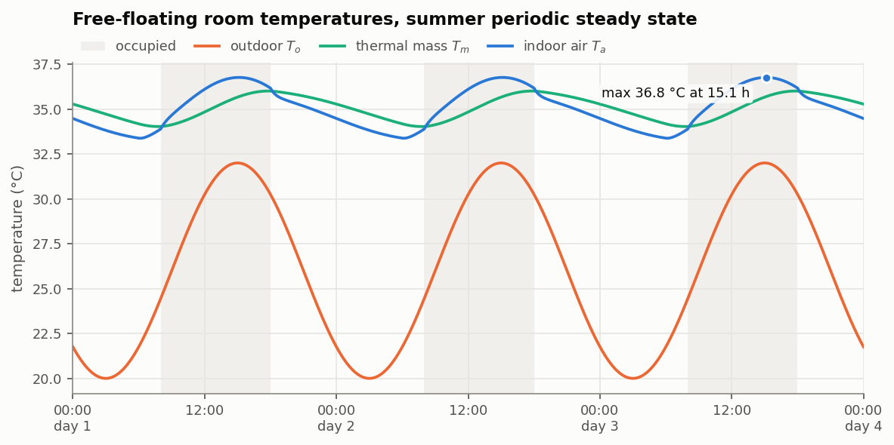
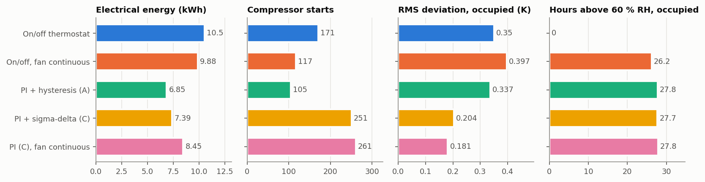
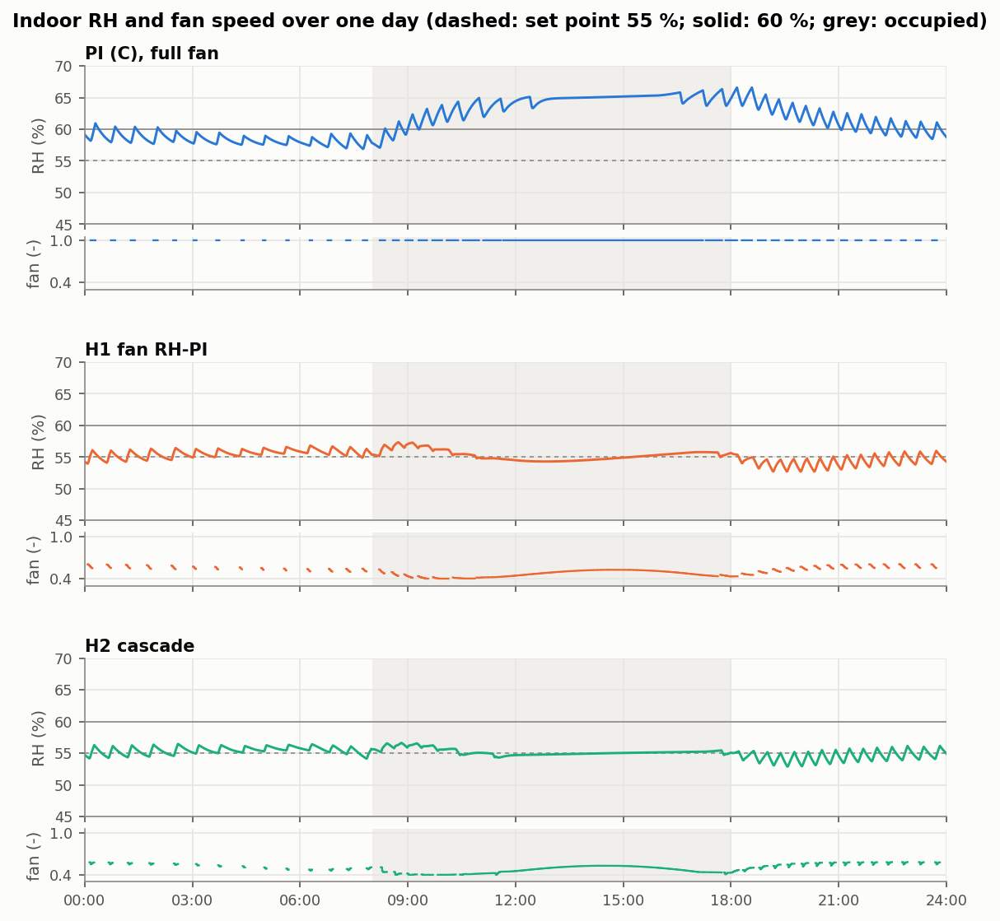
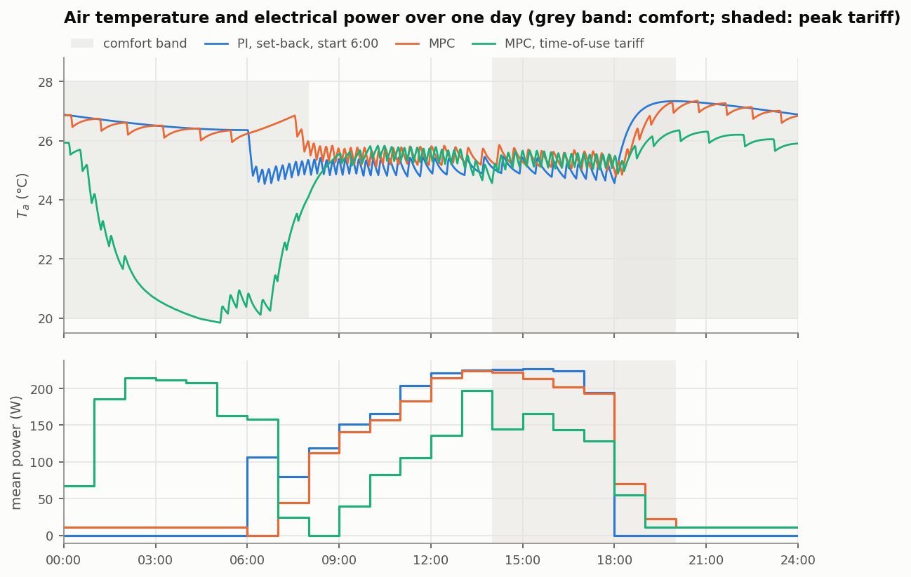
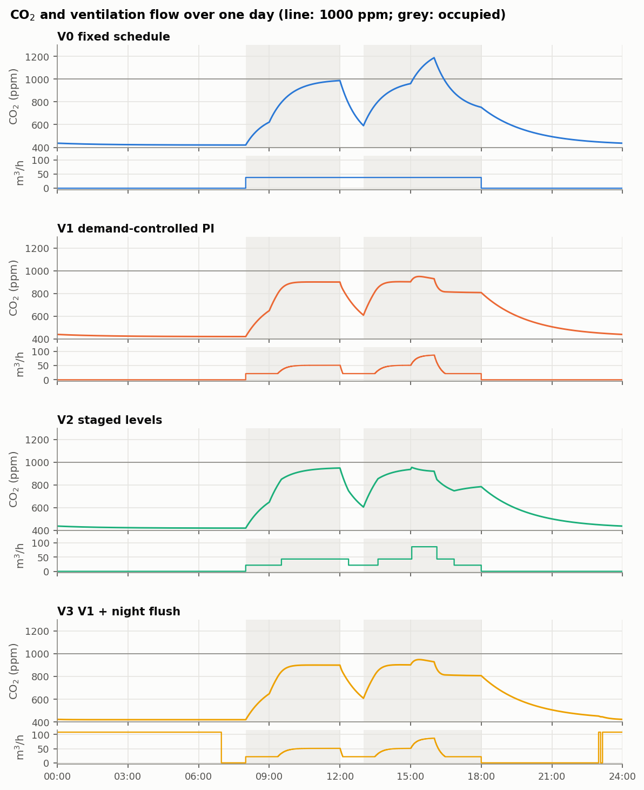

# Results

Each study can be reproduced with the script named in its section (see
[Install and run](../README.md#install-and-run) in the main README). The scripts also write
each table to `figures/`. Where a study was designed before running it, the design is in
[decisions.md](decisions.md).

Abbreviations used below: RH, relative humidity; PI, proportional-integral controller; EER,
energy efficiency ratio (cooling delivered per unit of electrical energy); SHR, sensible heat
ratio (sensible over total cooling); MPC, model-predictive control; ach, air changes per hour.

## Free-floating baseline

Script: `scripts/run_baseline.py`.

Without air conditioning, on the **periodic steady state** found by Newton shooting on the
one-day map, the room peaks at **T_a,max = 36.8 °C at 15:07** (minimum 33.4 °C, indoor RH
35-39 %). With 0.5 ach, an unshaded window and about 340 W of mean gains, the room sits ~9 K
above the mean outdoor temperature. Starting from a uniform 26 °C instead underestimates the
peak by almost 4 K on day 3, because the mass takes about three days to respond.

## Standard controllers

Script: `scripts/compare_controllers.py`.

Three summer days after three warm-up days, set point 25 °C, ventilation 38 m³/h during
occupied hours (mean CO2 950 ppm):

| Controller | Energy (kWh) | Starts | T rms occ. (K) | RH mean occ. (%) | h RH > 60 % occ. |
|---|---|---|---|---|---|
| On/off thermostat (±0.5 K, full speed) | 11.38 | 174 | 0.35 | 49.2 | 0.0 |
| On/off, fan continuous | 9.92 | 117 | 0.40 | 64.1 | 26.2 |
| PI + hysteresis low-load handling (A) | 6.53 | 66 | 0.25 | 64.1 | 28.4 |
| PI + sigma-delta low-load handling (C) | 6.85 | 169 | 0.19 | 63.7 | 27.6 |
| PI (C), fan continuous | 7.89 | 177 | 0.18 | 63.7 | 27.6 |

"T rms occ." is the root-mean-square deviation of the air temperature from the set point while
occupied; "h RH > 60 % occ." is the number of occupied hours above 60 % RH.

**The PI uses 40 % less energy but loses humidity control.** The unit is large for this office,
so the PI keeps it at minimum speed for most of its running time (69 % for handler C). At
s = 0.3 and full fan the coil surface sits at 18.3-19.4 °C once the start-up ramp has decayed,
above the dew point of the room air (about 17.7 °C while occupied): the coil runs dry and
removes no water at all (SHR 1.00 against 0.80 for on/off). The mean EER rises from 2.6 to
3.9, but indoor RH climbs to 64 %. Recovering dehumidification at part load is the subject of
the next section.

The script does not print these mean values. They come from the same runs (PI with handler C
and the on/off thermostat): EER as heat taken by the refrigerant over electrical energy, fans
included; SHR as sensible over sensible plus latent cooling, both summed over the three days;
coil range over the minimum-speed, full-fan samples from 5 minutes after each start.

**Leaving the fan on between cycles returns the condensate to the room.** With the on/off
thermostat, continuous fan raises the mean RH from 49 % to 64 %: the water held on the coil
re-evaporates during the off periods, and none of it reaches the drain over the three days.
This is the mechanism of part-load latent degradation in cycling units described by Henderson
and Rengarajan (1996; see [references.md](references.md)). Under PI control the unit modulates
rather than cycles during occupied hours, so the effect there is small.

**Low-load handling.** Below the 30 % minimum speed the compressor has to cycle. The PI computes
a continuous demand and a separate handler turns it into feasible commands, with minimum run and
stop times of 3 min. Handler A (thermostatic hysteresis, integrator frozen) switches like a
thermostat around the minimum speed; handler C (sigma-delta) meets the mean demand, so the PI
keeps integrating.

- **Time scale of the sigma-delta handler.** It follows from the ripple it causes. Between
  switches the energy mismatch is stored in the air, so the peak-to-peak ripple is
  s_min T_ref Q_d / C_a, with Q_d the sensible cooling per unit of demand at minimum speed (dry
  coil). T_ref = 210 s gives 0.5 K. Measured over about 100 low-load cycles in closed loop:
  median 0.50 K.
- **Clamped accumulator.** A deficit held back by the minimum run or stop time is not paid back
  later; paying it back had kept the unit off while the room was already warm.
- **Outcome.** Handler C gives the tightest temperature control, with more but shorter cycles
  than A: 169 starts against 66, or 4.5 starts per running hour against 1.8 for A and 11 for
  on/off.

## Humidity-aware fan control

Script: `scripts/compare_humidity.py`.

The indoor fan is the dehumidification actuator: less airflow means a colder coil and a lower
sensible heat ratio. At minimum compressor speed (room at 25 °C and 60 % RH, 32 °C outdoors),
going from full to 40 % fan takes the coil from 19 °C (dry) to 15 °C (wet), SHR 1.00 to 0.75,
for a 5 % loss of EER. The sensible cooling per unit of electricity falls by 28 %, because a
quarter of the cooling now removes water. The compressor stays under the same PI temperature
loop; two structures drive the fan:

- **H1**: a relative-humidity PI acting directly on the fan speed.
- **H2, cascade**: the RH loop sets a coil-temperature target, and an inner loop on the
  evaporator thermistor moves the fan to reach it.

Set points 25 °C and 55 % RH:

| Controller | Energy (kWh) | Water removed (kg) | RH mean occ. (%) | RH std occ. (%) | h RH > 60 % occ. |
|---|---|---|---|---|---|
| PI (C), full fan | 6.85 | 0.0 | 63.7 | 1.95 | 27.6 |
| H1 fan RH-PI | 7.56 | 5.3 | 55.3 | 0.81 | 0.0 |
| H2 cascade | 7.55 | 5.3 | 55.2 | 0.55 | 0.0 |
| On/off (reference) | 11.38 | 10.0 | 49.2 | 1.54 | 0.0 |

Water removed is the condensate drained over the three days (the water held on the coil is
the same at both ends), taken from the integrated drain total.

Both bring the humidity back to its set point for 10 % more energy than the plain PI, still 34 %
less than on/off. The two structures have the same mean performance; the cascade holds humidity
more steadily and moves the fan somewhat less. Keeping the controllers tuned for the nominal
unit and running them on a different one (dirty coil with bypass factor 0.30, or a 3.5 kW unit)
gives the same ordering: across the three units the RH standard deviation is 0.49-0.59 % for the
cascade against 0.81-0.96 % for H1. The advantage is real but small, as expected when the outer
process (room humidity) is much slower than anything the inner loop rejects.

## Model-predictive control

Script: `scripts/compare_mpc.py`.

An economic MPC plans the air temperature over the next 24 h in 15-minute steps and re-plans
every 15 minutes. It minimises:

- the forecast electrical energy (the unit's coefficient of performance, COP, is better in the
  cool hours), weighted by the electricity price when there is a tariff;
- a penalty for leaving the comfort band (25 ± 1 °C while occupied, up to 28 °C otherwise);
- a small penalty on changes of the planned cooling.

The prediction model is the linear two-node RC model, discretised exactly; it knows nothing
about humidity, the coil or the unit's part-load behaviour. The cost and constraints are linear
(the absolute changes of cooling are written with auxiliary variables), so each plan is a
linear programme, solved with the HiGHS solver through SciPy in about 10 ms.

A Kalman filter on the air-temperature sensor estimates the unmeasured mass temperature and an
unknown heat input to the air. The second state makes the predictions offset-free: whatever the
model gets wrong shows up as a disturbance that the planner then compensates. Started 3 K wrong
on the mass temperature, the estimate converges without bias but slowly (time constant ~14 h),
because with a single air sensor a wrong mass temperature and an unknown heat input can only be
told apart through the slow mass mode.

The MPC supervises the PI rather than driving the compressor directly. Applying the planned
cooling directly, with the low-load handler turning it into cycling between the 15-minute
solves, left the cycling without feedback and produced 3.75 K·h outside the band over three days.
In the final structure the plan sets the PI's set point, and the PI (60 s) does the tracking and
the cycling. The planner keeps 0.6 K inside the occupied band for the PI's ripple; the margin
was chosen from a sweep (0.3 K: 0.38 K·h outside the band, 0.6 K: 0.01 K·h, for 4 % more energy;
see D18 and D21 in [decisions.md](decisions.md)).

Three days, ventilation during occupied hours, tariff 0.15 / 0.60 EUR/kWh with the peak 14-20 h:

| Controller | Energy (kWh) | Cost (EUR) | K·h outside band | Starts |
|---|---|---|---|---|
| PI, 25 °C constant | 6.85 | 2.26 | 0.000 | 169 |
| PI, set-back, fixed start 6:00 | 5.96 | 1.96 | 0.000 | 51 |
| MPC | 5.80 | 2.02 | 0.009 | 79 |
| MPC, time-of-use tariff | 6.39 | 1.97 | 0.000 | 150 |
| MPC, model parameters off by 20 % | 5.85 | 2.01 | 0.000 | 94 |
| MPC, forecast +2 K and -30 % sun | 5.80 | 2.02 | 0.008 | 77 |

The cost column applies the time-of-use tariff to every run, including those whose controller
does not know about it.

- **Against a well-configured PI the energy saving is small**: 3 % against set-back with a fixed
  early start, 15 % against a constant set point. Most of what the MPC finds (let the room float
  at night, start just in time, sit at the warm edge of the band) a PI with a good schedule
  already gets.
- **A time-of-use tariff does not pay off here.** With the tariff the MPC pre-cools overnight,
  storing cold in the thermal mass, and lowers its own cost by 2.5 %, but ends level with the
  set-back PI (1.97 against 1.96 EUR) while using 7 % more energy. An earlier version reported a
  10 % saving; the end-of-project check traced it to an unbounded cycle COP at night (above
  17 at 20 °C outdoors), which made night-time cooling look almost free. With a minimum
  condensing lift the advantage disappears (decision D20).
- **Robustness**: 20 % errors in five model parameters, or a forecast 2 K too warm with 30 % less
  sun, change the energy by less than 1 % and keep the comfort criterion. The Kalman disturbance
  state absorbs both.

**Load shifting has a threshold and a ceiling.** Single 24-hour plans (planner only, no closed
loop) were computed with different peak/off-peak price ratios, starting at 6:00 on the third day
from the state used in the tests (air 26.5 °C, mass 27.0 °C). The table gives the share of
planned cooling in the 14-20 h window that moves out of it, compared with a flat price:

| Planning band | Ratio 2.5 | Ratio 3 | Ratio 4 | Ratio 5 | Ratio 6 to 10 |
|---|---|---|---|---|---|
| 25 ± 1 °C, margin 0.6 K (default) | 0.2 % | 2.3 % | 5.4 % | 9.5 % | 14-15 % |
| 25 ± 1 °C, margin 0.3 K | 0.1 % | 4.0 % | 8.0 % | 16 % | 21 % |
| 25 ± 1.5 °C, margin 0.6 K | 0.0 % | 5.2 % | 9.3 % | 20.5 % | 25-26 % |

Below a ratio of about 3 almost nothing moves; from about 6 the share stops growing, at a level
set by how far the planner may pre-cool. Pre-cooling the air pulls heat out of the strongly
coupled mass (180 W/K), and much of it leaks back before the peak. The tariff of the closed-loop
runs above has a ratio of 4. These planning runs are not part of the scripts; the test suite
checks the two ends (no shift at a ratio of 2, a shift at 6).

## Ventilation

Script: `scripts/compare_ventilation.py`.

Ventilation strategies, all with the same temperature and humidity control (PI with sigma-delta
handling and the coil cascade), so differences come from ventilation only. The fan follows the
affinity law (30 W at 108 m³/h). The requirement is CO₂ ≤ 1 000 ppm while occupied. Strategies,
parameters, requirement and expected outcomes were committed before the runs
([decisions D23-D27](decisions.md)).

- **V0:** fixed schedule, 38 m³/h, close to the ASHRAE Standard 62.1 breathing-zone rate for
  two people in this office (D24).
- **V1:** PI on measured CO₂, set point 900 ppm, tuned with Skogestad's SIMC rules from the
  CO₂ balance.
- **V2:** three fan levels switched on CO₂ with hysteresis and a 5-minute dwell. This is the
  generic form of staged demand-controlled ventilation.
- **V3:** V1 plus mechanical night flush when the outdoor air is at least 2 K cooler than the
  room.

The ventilation rate and the SIMC rules are referenced in [references.md](references.md).

Variable office day (late arrival, empty at lunch, a 3-person meeting at 15 h, early leave):

| Strategy | Total energy (kWh) | Air (m³) | CO₂ max occ. (ppm) | h > 1 000 ppm |
|---|---|---|---|---|
| V0 fixed schedule (sized for 2 people) | 7.34 | 1134 | 1189 | 3.9 |
| V0 sized for the 3-person peak (exploratory) | 7.96 | 2095 | 966 | 0.0 |
| V1 demand-controlled PI | 7.40 | 1176 | 949 | 0.0 |
| V2 staged levels | 7.42 | 1180 | 955 | 0.0 |
| V3 V1 + night flush at 108 m³/h | 7.45 | 3736 | 949 | 0.0 |

Total energy is the air conditioner plus the ventilation fan over three days. The design case
(two people all day) and the flush-flow sweep are in `figures/ventilation_comparison.md`.

- **Demand control earns its keep only when occupancy varies.**
  - With two people present all day, V1 and V2 used more air than the fixed schedule (1 438
    and 1 366 against 1 134 m³). There was nothing to exploit, and their 900 ppm set point is
    stricter than where the fixed flow ends up (≈ 1 000 ppm).
  - With variable occupancy, the fixed flow breaks the requirement during and after the
    meeting.
  - A fixed flow sized for the peak meets it, but with 78 % more air and 8 % more energy than
    demand control.
- **Staged levels perform like the continuous PI** (energy within 0.3 %, peak CO₂ within 6 ppm).
  Three levels are enough here; the continuous loop adds nothing measurable.
- **Night flush pays only at reduced flow.** At the full 108 m³/h it saves 0.66 kWh of
  compressor energy but the fan uses 0.71 kWh more. An exploratory sweep of the flush flow
  (design case) gives the lowest total at 54-72 m³/h: 3.6 % below V1, because fan power falls
  with the cube of the flow while the free cooling falls roughly linearly. The cube law assumes
  a fixed duct system; a fan under constant-pressure control would save less at reduced flow.
